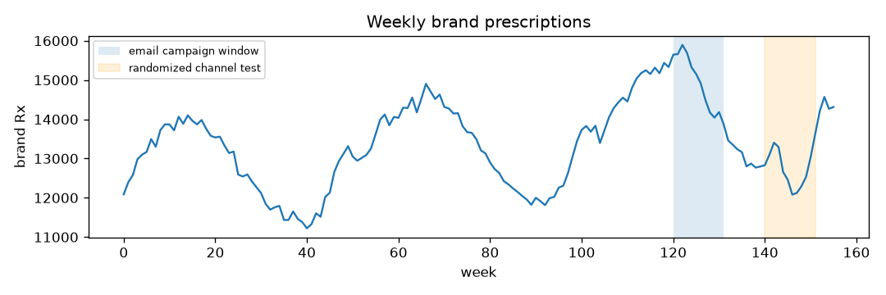
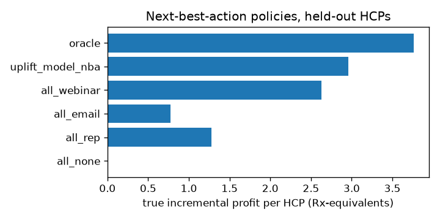

# Results

Seed 7, 3000 HCPs x 156 weeks; run took 14.8 s.

## Segmentation (k-means, k by silhouette)

k = 5; adjusted Rand index against the planted archetypes = 0.35.

|   segment |   patient_volume |   rx_per_patient |   rx_trend_slope |   email_open_rate |   webinar_attend_rate |   rx_26w |   hcps |
|----------:|-----------------:|-----------------:|-----------------:|------------------:|----------------------:|---------:|-------:|
|         0 |           58.617 |            0.188 |           -0.174 |             0.293 |                 0.667 |  291.561 |    421 |
|         1 |           32.106 |            0.151 |           -0.018 |             0.323 |                 0.811 |  128.62  |   1183 |
|         2 |           14.261 |            0.049 |           -0.007 |             0.181 |                 0.553 |   18.407 |    668 |
|         3 |           36.208 |            0.156 |           -0.03  |             0.287 |                 0.032 |  153.266 |    399 |
|         4 |           24.324 |            0.112 |           -0.009 |             0.843 |                 0.674 |   81.459 |    329 |

## Forecasting (weekly Rx by region, rolling origin, horizons 1-4)

| model | WAPE | MAPE |
|---|---|---|
| seasonal_naive | 2.43% | 2.41% |
| holt_winters | 1.94% | 1.93% |
| gbm | 2.52% | 2.51% |

## Targeting (who engages with email next quarter)

1528 eligible HCPs, 28.9% engaged.

| scorer | AUC | lift in top 20% |
|---|---|---|
| rule_past_open_rate | 0.621 | 1.18 |
| logistic_regression | 0.686 | 1.63 |
| gradient_boosting | 0.699 | 1.78 |

## Campaign effectiveness (Rx per targeted HCP, weeks 120-131)

| estimator | estimate |
|---|---|
| planted true ATT | 3.017 |
| naive post-period difference | 0.58 |
| difference-in-differences | 3.227 |
| IPW difference-in-differences | 3.35 (95% bootstrap CI 2.398 to 4.3) |

## Next best action (randomized test, held-out half)

| policy | true profit / HCP | IPS estimate / HCP |
|---|---|---|
| all_none | 0.0 | 0.0 |
| all_rep | 1.279 | 1.164 |
| all_email | 0.773 | 0.973 |
| all_webinar | 2.63 | 2.359 |
| uplift_model_nba | 2.963 | 2.256 |
| oracle | 3.762 | - |

Uplift policy captures 79% of oracle profit; best single channel is `all_webinar`; recommended mix {'webinar': 0.488, 'email': 0.184, 'none': 0.171, 'rep': 0.157}.

